### 💫 Hi 👋, I'm Mitaro

📫 Email me at [miri.saro@bk.ru](mailto:miri.saro@bk.ru) for collaboration, projects, or anything else 🙂

- 🔭 Building **[Campus](https://github.com/mitaro-cs/Campus)**, a local-first site and app for a study group
- 🎓 Omar, computer science student at MTUCI, Moscow
- 🌱 Currently learning: security (encryption, hashing), Rust and Tauri
- 🤖 Prototyping a personal AI assistant, Jarvis-style
- 💬 How to reach me: [Telegram](https://t.me/treadways)
- ⚡ Fun fact: about a third of my commits land after 22:00

 

## 💻 Tech Stack:

<picture><source media="(max-width: 600px)" srcset="assets/stack-mobile.svg"></picture>

## 🌐 Socials:

## 🚀 Core Project

<a href="https://github.com/mitaro-cs/Campus"><picture><source media="(max-width: 600px)" srcset="assets/campus-mobile.svg"></picture></a>

<b>Run Campus</b>

1. Download the installer from the [latest release](https://github.com/mitaro-cs/Campus/releases/latest): `macos-apple-silicon.dmg`, `macos-intel.dmg` or `windows-setup.exe`.
2. Install it. The app is not signed, so the system asks once: on macOS use System Settings → Privacy & Security → Open Anyway, on Windows More info → Run anyway.
3. On the first launch enter the group name, your name and a password: you become the admin and the group leader.
4. Management → Server → CloudPub → Open access gives a permanent link and a QR code for the group.

Classmates open the link, sign in and add the site to their home screen as an app.

## 🏆 GitHub Trophies

<picture><source media="(max-width: 600px)" srcset="assets/trophies-mobile.svg"></picture>

## 🧩 Other Projects

- 🔐 [VantaVault](https://github.com/mitaro-cs/VantaVault): a private vault for external drives
- ☁️ [AetherCloud](https://github.com/mitaro-cs/AetherCloud): your own disk as a private cloud
- 🪑 [Kworking](https://github.com/mitaro-cs/KworkingSystem): a booking panel for a campus coworking space
- 🐍 [Mouros](https://github.com/mitaro-cs/Mouros): my Python practice archive

## 🏅 Achievements

- 🚀 **Campus 1.0** shipped: a desktop host app for macOS and Windows, phones that work offline, passkeys and 2FA
- 🔀 Campus runs CI on every pull request: Java tests, Playwright end-to-end tests and linters
- 🔐 Encryption at rest with AES-256-GCM, passwords hashed with Argon2id, WebAuthn written without libraries

## 🛠️ Focus

`Java` · `Spring Boot` · `Svelte` · `SQLite` · `Local-first` · `Security` · `Networking`

## 📊 GitHub Stats:

<picture><source media="(max-width: 600px)" srcset="assets/stats-mobile.svg"></picture>

Every picture here is drawn by a Python script in <code>/scripts</code> from the GitHub API and refreshed every six hours, in black and white like my avatar. The motion stops if your system asks for reduced motion.
